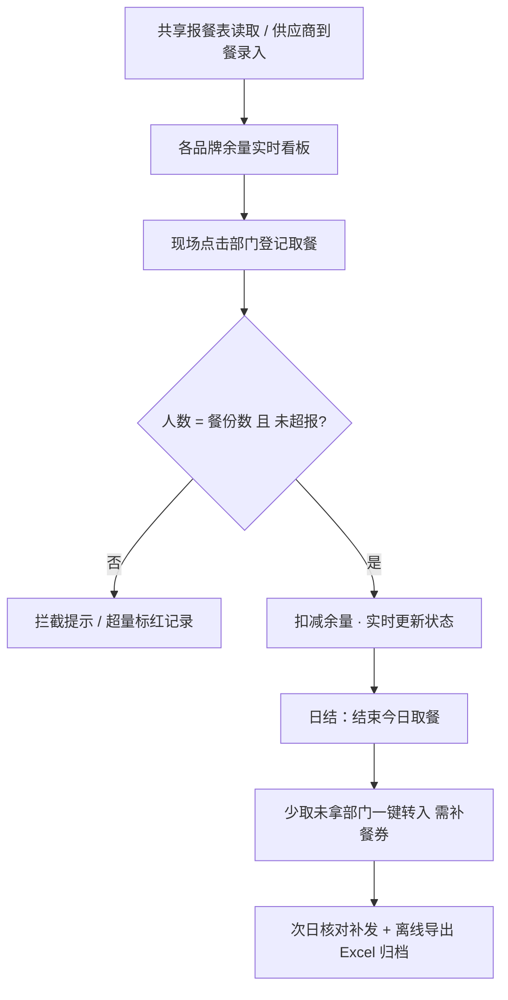

# 赖怡婷 Yiting Lai · 个人求职作品集

> 国际商务 × AI 业务落地与商业交付：懂一线业务痛点，能用 AI 快速做出可上线工具，并跑通真实商业闭环与低纠纷履约。

- 🔗 在线预览（GitHub Pages）：https://mmmmmmmm84.github.io/yiting-portfolio/
- 🔗 国内直连备用（Netlify）：`https://<站点名>.netlify.app`（待替换）

## 核心数据一览

| 指标 | 数据 |
|---|---|
| 双线累计真实交付 | 285+ 单（AI 工具 80+ 单 + C2C 电商 205 单） |
| 综合纠纷率 | 0.35%（AI 工具 0 纠纷，电商仅 1 笔） |
| AI 工具商业纯利 | 2,000+ 元 |
| 广交会实习表现 | 零错漏对账 · 获评“优秀实习生” |

## 作品集内嵌的 3 个真实可交互 Demo

1. **广交会移动端实时对账核对系统（`src/reconcile.html`）**
   - 还原真实上线的「取餐核对台」移动端页面，内置 10 月展会真实场次数据副本，纯前端本地运行。
   - 支持多品牌余量实时核对、超量/换餐/加餐拦截标红、一键日结转「需补餐券」及离线导出格式化 `.xlsx`。
2. **易班自动化脚本与商业化发卡系统（`src/yiban-card.html`）**
   - 还原真实上线的「易班发卡」页面，支持选择日卡/周卡/月卡/季卡/年卡/永久卡并批量生成带校验位激活码，一键复制至飞书多维表格配合桌面端 HWID 鉴权。
3. **智慧校园 3.0 校园活动代预约系统（`src/zhxy-order.html` + `assets/order-admin.png`）**
   - 还原真实上线的移动端在线下单前端（内置离线 Mock API 与真实活动数据），支持搜索、筛选、批量勾选下单与「我的订单」查询；并附真实「订单实时管理后台」截图。

## 广交会对账工具核心逻辑



## 技术与工程特点

- **纯静态零依赖**：不依赖任何海外 CDN 或外部字体，全站采用系统无衬线字体栈，微信内置浏览器秒开。
- **移动端优先（Mobile-First）**：兼容手机微信竖屏滑动与 PC 端宽屏左右分栏预览。
- **目录结构**：

```
portfolio/
├─ index.html            # 作品集主页（单文件内联 CSS/JS）
├─ src/
│  ├─ reconcile.html     # 项目 01：广交会取餐核对台（真实上线页）
│  ├─ demo-data.json     # 项目 01：真实场次数据副本
│  ├─ yiban-card.html    # 项目 02：易班发卡页（真实上线页）
│  └─ zhxy-order.html    # 项目 03：智慧校园 3.0 在线下单页（真实上线页）
├─ assets/
│  ├─ resume.pdf         # 赖怡婷个人简历 PDF
│  ├─ order-admin.png    # 项目 03：订单实时管理后台截图
│  ├─ credit.jpg         # 项目 04：闲鱼卖家信用 205 单 / 95% 好评
│  ├─ earnings.jpg       # 项目 04：累计成交流水 6,132.24 元
│  ├─ g2g-order.jpg      # 项目 04：G2G 海外已发货订单
│  └─ sold-list.jpg      # 项目 04：C2C 真实成交记录
├─ README.md
├─ DEPLOY.md
└─ .nojekyll
```

## 联系方式

赖怡婷 Yiting Lai · 手机 `13794875992` · 邮箱 `x60skim@gmail.com`
