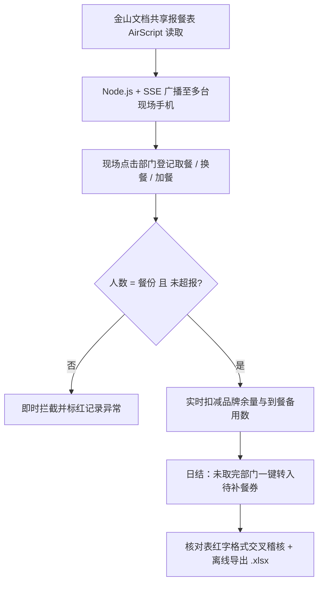

# 赖怡婷 Yiting Lai — 个人求职作品集

> 国际商务 × AI 业务落地与商业交付

- 在线作品集：https://x60skim.github.io/yiting-portfolio/
- 个人简历 PDF：[assets/resume.pdf](./assets/resume.pdf)

## 真实项目与数据库核验数据

| 项目 | 真实运行与商业数据 | 核心实现 |
|---|---|---|
| **01 广交会移动端实时对账核对系统** | 10 部手机同步 · 33 天 95 场 · 70,042 份餐品 · 核对从 50 分钟缩短至 5 分钟 · 零错漏 | Node.js + SSE 多端实时同步、共享表自动读数与标红稽核、离线 `.xlsx` 导出、断网本地容灾 |
| **02 智慧校园 3.0 校园活动代预约系统** | 1,225 场同步活动 · 861 笔订单 · 38 个已验账号 · 216 次名额置换 · 37 人签约占位 · 35 次免费掉落 | 前端自助下单查单网站 + 后端多账号高并发控制台、自动复核与待结账单生图 |
| **03 易班自动化桌面软件** | 线上实售 89 单 · 成交额 ¥1,286.00 · 100% 好评 · 0 纠纷 · 零服务器授权成本 | 桌面端一键安装包、自动读版块与防屏蔽提示、飞书表格零成本一机一码授权与更新提醒 |
| **04 线上销售实绩与 G2G 海外首单** | 累计 294 单 · 总成交额 ¥7,418.24（电商 ¥6,132.24 + 工具 ¥1,286.00）· 纠纷率 0.35% · G2G 首单 5.40 USD | C2C 全链路选品促单与售后风控、真实客户 100% 好评追评、G2G 全英文上架与 Payoneer 收款 |

## 广交会核对系统逻辑



## 目录结构

```
portfolio/
├─ index.html              # 极简编辑杂志风单页作品集（零外链 CDN，微信秒开）
├─ src/
│  ├─ reconcile.html       # 01 广交会取餐核对台（内联 10.16-10.24 真实场次数据）
│  ├─ zhxy-order.html      # 02 智慧校园 3.0 客户端自助下单网站
│  ├─ zhxy-console.html    # 02 智慧校园 3.0 后端桌面主控制台（全按钮可交互）
│  └─ yiban-client.html    # 03 易班自动化桌面客户端（全功能可交互）
├─ assets/                 # 简历 PDF、真实后台与成交/信用/G2G 官方结算单 PDF
├─ README.md
├─ DEPLOY.md
└─ .nojekyll
```

## 联系

赖怡婷 Yiting Lai · 13794875992 · x60skim@gmail.com
