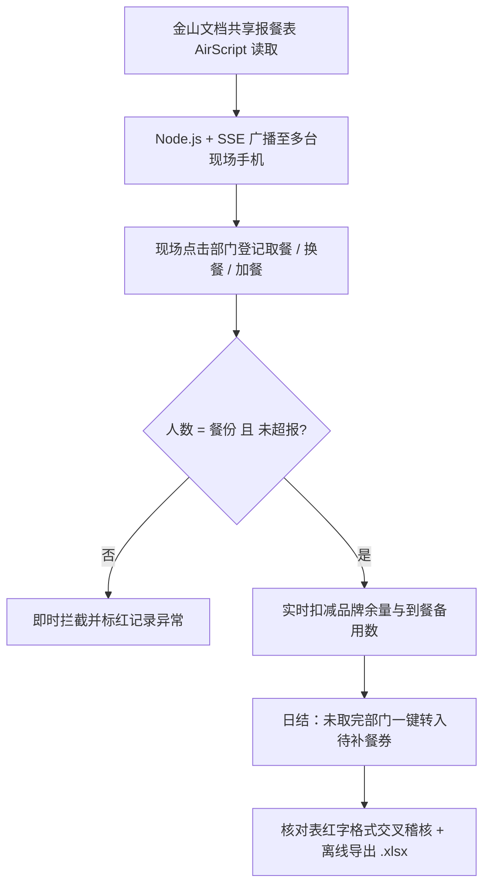

# 赖怡婷 Yiting Lai — 个人求职作品集

> 国际商务 × AI 业务落地与商业交付

- 在线作品集：https://mmmmmmmm84.github.io/yiting-portfolio/
- 个人简历 PDF：[assets/resume.pdf](./assets/resume.pdf)

## 真实项目与数据库核验数据

| 项目 | 真实运行与商业数据 | 核心实现 |
|---|---|---|
| **01 广交会移动端实时对账核对系统** | 33 天展期 · 95 场次 · 70,042 份餐品 · 1,284 笔登记 · 55 笔补餐券 · 零错漏 | Node.js + SSE 多端实时同步、金山文档 AirScript 双向读取与红字稽核、FRP HTTPS 穿透、离线 OOXML `.xlsx` 导出、断网本地容灾 |
| **02 智慧校园 3.0 校园活动代预约系统** | 1,225 场同步活动 · 861 笔订单 · 38 个已验账号 · 216 次名额置换 · 37 人签约占位协议 · 35 次免费掉落 | 34 个 Express REST API、首屏四合一 `/api/bootstrap`、SM4/AES 纯 Python HTTP 直连抢报、`preflight` 校验与抢单分析器、批量待结账单生图 |
| **03 易班自动化工作台与发卡体系** | AI 工具线独立交付 80+ 单 · 0 纠纷 · 纯利 ¥2,000+ · 零服务器鉴权成本 | CustomTkinter + DrissionPage + FastAPI + OpenCV、飞书多维表格 HWID 云端鉴权与版本更新、PyArmor + PyInstaller + Inno Setup 四步自动打包、校验位发卡页 |
| **04 独立电商与 G2G 跨境交易 MVP** | 老号 205 单 · ¥6,132.24 · 95% 好评 · 新号 100% 好评 0 纠纷 · G2G 首单 5.40 USD / 7,680 KRW | C2C 全链路选品促单与售后风控、G2G 入驻与全英文上架、Payoneer 收款配置与官方结算单 |

## 广交会核对系统逻辑



## 目录结构

```
portfolio/
├─ index.html              # 极简编辑杂志风单页作品集（零外链 CDN，微信秒开）
├─ src/
│  ├─ reconcile.html       # 01 广交会取餐核对台（内联 10.16-10.24 真实场次数据）
│  ├─ zhxy-order.html      # 02 智慧校园 3.0 客户端自助下单网站
│  ├─ zhxy-console.html    # 02 智慧校园 3.0 后端桌面主控制台（全按钮可交互）
│  ├─ yiban-client.html    # 03 易班自动化桌面客户端（全功能可交互）
│  └─ yiban-card.html      # 03 易班校验位批量发卡页
├─ assets/                 # 简历 PDF、真实后台与成交/信用/G2G 官方结算单 PDF
├─ README.md
├─ DEPLOY.md
└─ .nojekyll
```

## 联系

赖怡婷 Yiting Lai · 13794875992 · x60skim@gmail.com
